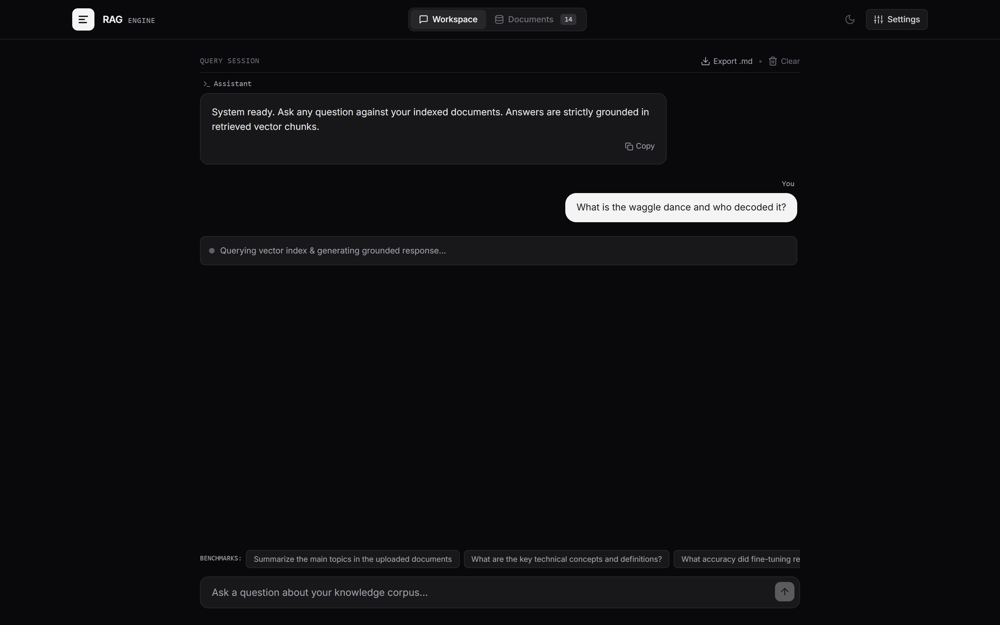
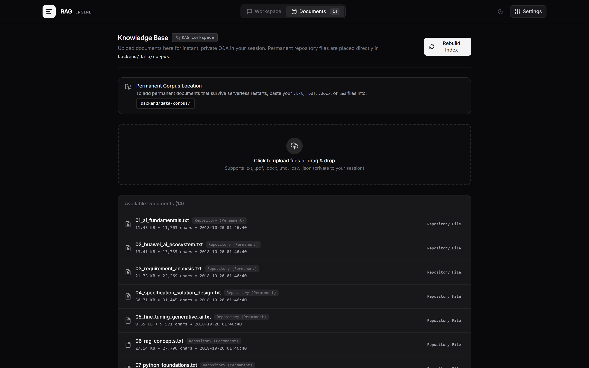
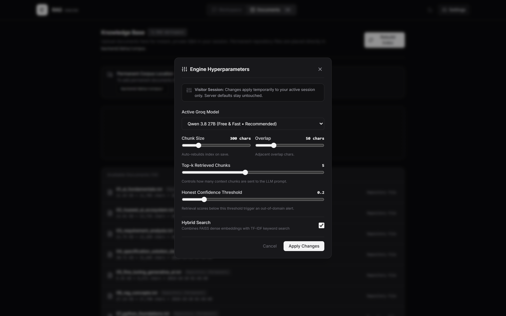
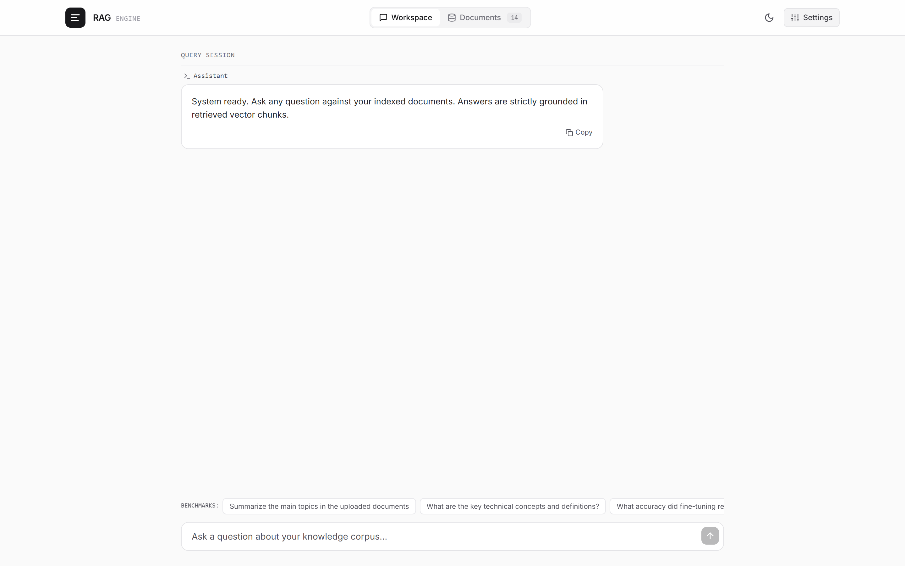

# Production RAG System (Retrieval-Augmented Generation)

[](https://fastapi.tiangolo.com/)
[](https://react.dev/)
[](https://github.com/facebookresearch/faiss)
[](https://tailwindcss.com/)
[](https://groq.com/)
[](https://rag-project-nu.vercel.app)

A full-stack, enterprise-ready Retrieval-Augmented Generation (RAG) platform extracted and evolved from the **Week 8 Day 2 Full RAG System** curriculum.

---

<div align="center">
  
  <p><em>Interactive Grounded Q&A with In-line Citations, Source Verification, and Meta-FAISS Retrieval</em></p>
</div>

---

## 📸 Interface & Visual Tour

### 1. Grounded Q&A Assistant (Dark Mode)
Ask natural language questions against the indexed corpus. Responses are strictly grounded in retrieved vector chunks with numbered in-line citations (`[Source 1]`) and file badges.


---

### 2. Knowledge Base & Document Manager
Manage the 14 permanent corpus files (`01` to `14`, including AI fundamentals, computer vision, scikit-learn, and biology). Visitors can upload temporary documents for sandboxed, private session queries.



---

### 3. Hyperparameter Tuning & Hybrid Search
Fine-tune engine parameters on the fly: Active LLM model, Chunk Size, Overlap, Top-k context window, Honest Confidence Threshold slider, and Hybrid (Dense + Sparse TF-IDF) Search toggle.



---

### 4. Clean Minimal Light Theme
Complete high-contrast Light Theme toggle for daylight work.



---

## 🌟 Key Features

1. **Recursive Chunking with Boundary Overlap:**  
   Intelligently slices text along paragraph (`\n\n`), newline (`\n`), sentence (`. `), and word boundaries, carrying forward overlap to avoid cutting critical facts in half.

2. **FAISS Dense Vector Store:**  
   Uses Meta AI's FAISS (`IndexFlatIP`, exact search) with L2-normalized 384-dimensional dense vectors, guaranteeing 100% recall.

3. **Signed Multi-Hash Embedding (Count-Sketch):**  
   Deterministic, zero-dependency feature extractor using SHA-256 with 4 independent hash slots and $\pm 1$ sign projection. Eliminates hash collisions and prevents false matches.

4. **Hybrid Search (Dense + TF-IDF Keyword):**  
   Blends semantic cosine search with TF-IDF keyword search, excelling at exact terms, model numbers, IDs, and domain-specific terminology.

5. **Honest Out-of-Domain Detection:**  
   Calculates similarity confidence scores against the similarity threshold. If an answer cannot be grounded in the context, it displays an out-of-domain warning to prevent hallucinations.

6. **Side-by-Side Evaluation:**  
   Optionally generates both **WITH RAG** (grounded context with source citations) and **WITHOUT RAG** (plain prompting) to evaluate model grounding in real time.

7. **Multi-Format Knowledge Base:**  
   Supports `.txt`, `.md`, `.pdf`, `.docx`, and `.json` documents with automated one-click FAISS re-indexing.

---

## 📁 Repository Structure

```
rag-project/
├── backend/
│   ├── app/
│   │   ├── api/
│   │   │   └── routes.py             # REST API: /query, /upload, /reindex, /documents, /stats, /settings
│   │   ├── core/
│   │   │   ├── chunker.py            # Recursive chunker with boundary preservation
│   │   │   ├── document_loader.py    # Multi-format doc reader (.txt, .md, .pdf, .docx)
│   │   │   ├── embeddings.py         # Embedding service (Count-Sketch signed multi-hash / transformers)
│   │   │   ├── vector_store.py       # FAISS IndexFlatIP vector database
│   │   │   ├── hybrid_retriever.py   # TF-IDF keyword + semantic hybrid search
│   │   │   ├── session_manager.py    # Guest session isolation for temporary uploads
│   │   │   └── rag_engine.py         # Grounded prompt builder & Groq LLM generator
│   │   ├── schemas/
│   │   │   └── models.py             # Pydantic models & validation
│   │   ├── config.py                 # Centralized settings & environment variables
│   │   └── main.py                   # FastAPI application & CORS
│   ├── data/
│   │   ├── corpus/                   # Permanent knowledge base documents (01 to 14)
│   │   └── storage/                  # Persistent FAISS index (1,353 vectors) & metadata
│   ├── tests/
│   │   └── test_rag.py               # Automated pytest suite (9 tests)
│   ├── Dockerfile                    # Containerization for backend hosting
│   ├── requirements.txt              # Backend dependencies
│   ├── run.py                        # One-command backend launcher
│   └── .env.example
│
├── frontend/
│   ├── src/
│   │   ├── components/
│   │   │   ├── Navbar.jsx            # Header & system navigation
│   │   │   ├── ChatView.jsx          # Interactive grounded Q&A with citations
│   │   │   ├── DocumentManager.jsx   # Dedicated file upload & database manager
│   │   │   └── SettingsModal.jsx     # Hyperparameters (k, threshold, hybrid search, model)
│   │   ├── App.jsx
│   │   ├── main.jsx
│   │   └── index.css
│   ├── package.json
│   ├── vite.config.js
│   └── vercel.json                   # Frontend Vercel configuration
│
├── docs/
│   └── screenshots/                  # High-resolution application screenshots
├── scripts/
│   └── capture_screenshots.mjs       # Headless screenshot automation script
├── vercel.json                       # Root Vercel configuration
└── README.md
```

---

## 🔒 Access Control: Permanent vs Temporary Files

- **Permanent Knowledge Base (`backend/data/corpus/`)**:
  - Contains 14 curated course documents indexed into 1,353 chunks.
  - Bundled directly into the repository and persistent across serverless deployments.
- **Guest / Visitor Mode**:
  - Anyone visiting the site gets an **isolated, temporary session**.
  - Any files they upload are sandboxed exclusively to their browser session.
  - Other users **cannot** see, search, or access guest files.
  - When the visitor leaves or closes the tab, temporary session files are wiped cleanly.

---

## 🚀 Quickstart Guide

### 1. Backend Setup (FastAPI + Groq)

```bash
# Navigate to backend
cd backend

# Install dependencies
pip install -r requirements.txt

# Configure your free Groq API Key
cp .env.example .env
# Edit .env and set: GROQ_API_KEY=gsk_...

# Run the server
python run.py
```
> The API will be available at: **http://localhost:8000**  
> Interactive OpenAPI documentation at: **http://localhost:8000/docs**

---

### 2. Frontend Setup (React + Vite)

```bash
# Navigate to frontend
cd frontend

# Install packages
npm install

# Start development server
npm run dev
```
> The frontend UI will be live at: **http://localhost:5173**

---

## ⚡ Groq Free Tier Integration

This system is configured to use Groq's high-speed free tier:
- **Default Model**: `qwen/qwen3.8-27b` (Ultra-fast, zero cost)
- **Supported Models**: `openai/gpt-oss-120b`, `openai/gpt-oss-20b`, `allam-2-7b`, `llama-3.3-70b-versatile`
- **Latency**: Sub-second responses with streaming/grounding.
- **Key Security**: `GROQ_API_KEY` is loaded from `backend/.env` and is strictly ignored in `.gitignore` so your key is never pushed to GitHub.

---

## ⚙️ Environment Variables

| Variable | Description | Default |
|---|---|---|
| `GROQ_API_KEY` | Free Groq API key from [https://console.groq.com/keys](https://console.groq.com/keys) | *Required* |
| `GROQ_MODEL` | Active model identifier | `qwen/qwen3.8-27b` |
| `ADMIN_PASSWORD` | Optional password for admin settings API endpoints | `""` |
| `SIMILARITY_THRESHOLD` | Honest confidence score threshold | `0.20` |
| `DEFAULT_CHUNK_SIZE` | Default characters per chunk | `300` |
| `DEFAULT_CHUNK_OVERLAP` | Character overlap between chunks | `50` |

---

## 📚 Notebook to Production Mapping

| Notebook Concept | Production Implementation |
|---|---|
| Recursive Chunking (`recursive_chunk`) | `backend/app/core/chunker.py` |
| Dense Vector Embeddings (`embed`) | `backend/app/core/embeddings.py` |
| FAISS Vector Index (`faiss.IndexFlatIP`) | `backend/app/core/vector_store.py` |
| Hybrid TF-IDF Keyword Search | `backend/app/core/hybrid_retriever.py` |
| Grounded Prompt Assembly (`build_prompt`) | `backend/app/core/rag_engine.py` |
| LLM Generation | `backend/app/core/rag_engine.py` |
| Honest Out-of-Domain Detection | `backend/app/core/rag_engine.py` & `ChatView.jsx` |
| Document Ingestion | `backend/app/core/document_loader.py` |

---

## 📜 License
MIT License. Created for the RAG curriculum and portfolio deployment.
